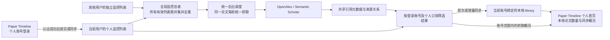

# Paper Timeline 与 Paper Monitoring 远程引用监控整合方案

> 本文保留整合方案的历史设计。当前桌面文献库已采用版本 2 的每篇论文独立资料文件夹，引用记录实际位于 `papers/<资料文件夹>/citations/`，全库同步状态仍在 `sync/`。目录、自动升级与复制规则以 [文献库布局与迁移](library-layout-guide.md) 为准；此变更不改变服务器接口与每日抓取调度。

- 文档日期：2026-10-20
- 最近修订：2026-10-21
- 文档状态：核心代码已实施并完成本地验证；线上部署与正式数据迁移尚未执行
- 本地客户端：当前仓库根目录
- 服务端项目：同级的 `../paper_monitoring/` 仓库
- 本阶段范围：本地个人首页、个人账号登录、个人监控列表、全局合并去重抓取、移除本地引用抓取、任务下发、本地同步结果、精简网页界面。

本文保留原始设计。2026-10-21 已按授权实现个人首页、登录、云端个人订阅与全局抓取、引用同步和网页精简；实际接口使用 `/api/desktop/v1/`，数据结构和使用、部署步骤以 [云监控实现指南](cloud-monitoring-guide.md) 为准。原“现状”章节描述改造前状态。线上服务器和正式用户数据尚未部署或迁移。

## 1. 目标与职责

将两个项目的职责明确为：

| 项目 | 主要职责 |
| --- | --- |
| Paper Monitoring | 认证个人账号、维护各用户独立的监控列表、合并为全局监控总表、统一抓取引用、按账号提供同步结果 |
| Paper Timeline | 展示个人首页和本地文献统计、登录个人账号、管理本地论文、发起或暂停个人监控、同步本账号结果、在本地整理和辅助阅读 |

电脑关闭后，服务器继续执行已接收的监控任务。本地软件再次打开并成功登录或恢复有效登录状态后，获取本账号期间积累的结果。仅服务器地址可访问，不代表已经获得个人资料的访问权限。

引用抓取统一由云服务器执行。Paper Timeline 删除本地直连外部引用来源的抓取功能和定时调度，不再提供本地抓取模式或断线回退。本地仍负责从云服务器同步已保存的结果，这一同步功能保留。

服务端分为两个层次：**每个用户拥有独立的个人监控列表；后台将所有有效个人监控列表取并集，形成按论文身份去重的全局监控总表。** 抓取调度只读取总表，同一篇论文即使被多个账号监控，也只执行一套抓取流程，再把结果关联到各自的个人列表。

例如，用户甲监控 A、B，用户乙监控 B、C，总表只有 A、B、C。B 的引用每轮抓取一次，甲和乙均可同步；甲不能读取乙的个人监控列表或私人阅读资料。

第一阶段只接通引用抓取和同步，不下载 PDF、不上传本地 PDF 或 Markdown 笔记，也不自动将全部引用加入主文献列表。分析、翻译、评分和辅助阅读后续逐项增加。



## 2. 已核实的现状

### 2.1 Paper Timeline

目前已经具备：

- 论文详情页中的引用监控开关。
- 开启后立即排队、之后每 10 分钟检查的本地调度。
- OpenAlex 和 Semantic Scholar 双来源抓取与去重。
- 每篇被监控论文独立的引用 JSON 文件。
- 监控状态、引用数量、最近更新和下次检查的显示。
- 复制文献库时一并复制引用数据。

上述为改造前的已实现能力：当前抓取在本地 Electron 主进程中执行，完全退出软件后停止，尚未接入远程监控服务器。按本次方案，将删除其中的本地引用抓取与定时执行能力，保留引用文件读写及历史数据。

相关代码：

- `electron/citation-monitor.ts`：本地调度与引用文件读写。
- `electron/citation-providers.ts`：外部来源查询、分页和去重。
- `electron/library.ts`：论文监控开关与共用业务入口。
- `src/CitationMonitorPanel.tsx`：详情页监控区域。
- `shared/citation-monitor.ts`：引用及监控状态类型。

### 2.2 Paper Monitoring

目前已经具备：

- Django 后端、Vue 前端和按账号隔离的数据。
- `Paper`、`PaperMetadata` 和 `PaperExternalIdentifier` 等论文模型。
- OpenAlex 和 Semantic Scholar 引用抓取。
- `UserCitation` 去重引用记录，以及 `CitationSource` 引用来源关系。
- 监控开关、手动刷新和全量 JSON 导出接口。
- 可撤销的 MCP 访问令牌及只读 MCP 能力。
- PostgreSQL 存储和 systemd 服务部署方式。

已有服务端定时任务按每天固定时间执行，不是按每篇论文每 10 分钟执行。现有 `/api/papers/export/` 返回账号的全量数据，尚无面向桌面客户端的增量同步协议。

现有 Paper 和 UserCitation 都归属于具体账号，调度按各账号的 Paper 记录处理。现有去重主要解决同一用户的引用聚合，尚未实现跨账号的全局监控总表和共享抓取任务，需要新增这一层。

部分抓取异常目前只记录日志，后续需要将来源失败、未匹配和真实零引用明确区分并返回客户端。

2026-10-20 检查时，服务器上的 `paper-monitoring-web.service`、`paper-monitoring-citations.timer` 和 `paper-monitoring-ai.service` 均处于运行状态。该结果仅代表当时状态，本次文档修订未重新检查服务器。

相关代码：

- `backend/apps/papers/models.py`：论文、引用、来源关系和令牌模型。
- `backend/apps/papers/citations.py`：抓取和引用保存逻辑。
- `backend/apps/papers/views.py`：监控、手动刷新和数据导出接口。
- `backend/apps/papers/management/commands/monitor_citations.py`：开发环境每日调度。
- `deploy/systemd/paper-monitoring-citations.timer`：生产环境每日定时器。
- `frontend/src/App.vue`、`frontend/src/components/AppShell.vue`：网页主入口与导航。

## 3. 网页端精简

登录后的主界面改为简洁的服务控制台，不再展示大量论文、引用列表和阅读详情。

控制台保留：

- 服务运行状态。
- 当前账号正在监控的论文数量。
- 当前账号相关的最近抓取时间、等待任务数量和失败任务数量。
- 本账号已登录设备或文献库的概况。
- 桌面登录会话的查看与撤销。
- 必要的错误摘要和账号管理入口。

各用户的监控列表仍在后台独立维护，不要求重新在网页上展示完整论文列表。全局监控总表、全站任务统计和其他用户信息只在授权的服务管理范围内可见，不提供给普通账号。

引用动态、引用图谱、归档阅读和论文阅读详情退出主要界面。第一阶段保留底层模型、历史数据及必要的兼容接口，待桌面同步稳定后再清理不再使用的前端代码。

新增的桌面监控任务默认不触发自动翻译或 AI 评分。需要显式处理现有抓取流程中的自动 AI 入队逻辑，避免仅因创建了引用记录而调用模型。既有 AI 结果保留，历史任务及队列按迁移方案处理。

## 4. 本地账号登录与“远程服务”设置

在 Paper Timeline 顶部“文献库设置”附近增加“远程服务”入口。

| 项目 | 说明 |
| --- | --- |
| 服务器地址 | Paper Monitoring 的 HTTPS 服务地址 |
| 账号登录 | 使用 Paper Monitoring 的个人账号和密码登录 |
| 测试连接 | 检查服务可达性和接口兼容性；个人数据必须在登录成功后读取 |
| 当前账号 | 显示服务端确认的账号身份、登录状态及退出登录入口 |
| 保持登录与自动同步 | 软件启动时恢复有效会话，认证成功后同步本账号数据 |
| 立即同步 | 登录状态有效时，手动获取本账号待同步结果 |
| 连接状态 | 未配置、未登录、登录中、已登录并连接、离线或登录失效 |
| 最近同步 | 最近成功同步时间及异常说明 |

用户正常操作以“登录账号”的方式完成，不要求手动生成和粘贴 API 令牌。服务端在登录成功后签发专用桌面会话凭证，客户端在后台携带该凭证访问接口。

### 4.1 登录与个人资料拉取

1. 用户填写服务器地址，并使用已有 Paper Monitoring 个人账号登录。
2. 服务端验证账号和密码，返回账号的稳定标识、基本资料及桌面会话凭证。
3. 客户端确认文献库绑定身份后，才能获取该账号的个人监控列表、任务状态和相关引用结果。
4. 软件重启时可以恢复有效登录状态；会话过期后先完成续期或重新登录，再继续同步。

未登录、登录失败、会话失效或账号不匹配时，禁止个人资料拉取和监控要求下发。已经明确绑定账号的本地库可以保存离线待发送操作，但必须等待同一账号重新认证。

个人资料同步首先包含账号基本资料、个人监控列表及引用相关状态，不把服务器上所有资料自动写入本地主文献列表。已有笔记、评分及其他阅读功能的迁移仍按后续范围单独处理。

### 4.2 会话与文献库绑定

第一版按“一个文献库绑定一个服务器账号”实现，使用服务端稳定账号 ID 识别身份，不以可修改的显示名称作为唯一依据。

退出登录后停止个人资料请求和待发送操作，撤销当前设备的服务端会话并清除本机登录凭证。离线退出时先清除本机凭证并停止通信，远端会话是否已撤销需明确提示。退出登录不自动暂停已提交的服务器监控任务。

切换账号时不能沿用前一个账号的同步游标、任务映射或待发送队列。已有绑定库与新账号不一致时，停止同步，要求选择相应文献库或明确办理迁移；不自动向新账号上传原账号的数据。

第一阶段不提供本地缓存加密访问控制；退出登录后已落盘的文献仍按本地文件管理，不能把登录退出描述成删除或封锁这些文件。

客户端通过业务 API 访问服务，SSH 用于部署和维护。软件中不配置服务器 root 登录信息或 SSH 私钥。

账号密码不保存到文献库或日志。桌面会话凭证使用系统凭据保护机制保存，不写入可复制的 `library` 数据文件。更换电脑后重新登录原账号，但保留文献库与远程任务的对应关系。

服务端新增桌面会话类型及续期、过期和撤销机制，至少明确“管理个人监控任务”和“读取个人同步数据”的权限范围。现有只读 MCP 令牌不自动获得写入权限。

现有部署文档记录了 `8081` 入口；实施时需要核对实际代理配置，提供带有效证书的 HTTPS API 入口。具体域名和路径在部署阶段确定。

### 4.3 Paper Timeline 本地个人首页

增加独立的“个人首页”，作为进入软件后的默认概览页；导航提供“首页”和“文献库”，文献库内保留现有列表与时间线视图。切换首页不重置列表筛选、选中论文或时间线的缩放位置。

首页上方显示当前文献库、登录账号及云端连接状态，提供“登录/远程服务设置”“立即同步”和“打开文献库”等入口。主体使用简洁统计卡片，避免重新在首页堆放完整论文列表。

首版统计内容及口径：

| 指标 | 统计口径与数据来源 |
| --- | --- |
| 本地论文总数 | 当前打开的 library 中全部论文条目数量；包括无 PDF 的条目，不受当前搜索或标签筛选影响，不把同一论文在多条时间线上的展示重复计数 |
| 附件概况 | 当前库中有 PDF 的论文数、有 Markdown 笔记的论文数，可作为本地论文卡片的辅助信息 |
| 当前库云端监控数 | 当前库绑定关系中已获服务器确认的有效监控论文数，待发送要求单独计数 |
| 服务器最近抓取时间 | 服务端返回的、与当前库有效个人订阅相关的最近一次成功抓取完成时间；不使用其他账号或不相关任务的时间 |
| 本地最近同步时间 | 当前库最后一次完整成功同步并落盘的时间；分页同步进行中单独显示进度，不提前标记完成 |
| 本次同步新增引用 | 本次同步首次保存到当前库的引用论文去重数量；同一引用来自多篇监控论文时只计一次，新增来源关系不冒充新增论文 |
| 待处理与异常概况 | 待提交监控要求、待暂停要求、同步失败和来源异常的数量或简短提示 |

“服务器最近抓取”与“本地最近同步”使用两个独立字段和卡片标签。前者表示云端何时从外部来源成功获取数据，后者表示本机何时保存云端结果。服务器最近一次失败尝试不覆盖最近成功时间，失败和部分来源成功另行提示。

服务器最近抓取时间取相关任务成功时间的最大值，只代表其中最近的一次成功，不表示所有监控论文均已更新。首页同时显示等待、失败或数据未更新的概况，避免一条任务成功掩盖其他任务的异常。后台时间统一保存为标准时间戳，界面按用户本机时区显示并提供明确时区信息。

首次登录且没有抓取记录时显示“尚未抓取”；没有有效云端监控时显示“暂无云端监控”；尚未完成同步时显示“尚未同步”。不使用软件启动时间、登录时间或当前时间填充缺失的抓取记录。

未登录或离线时，首页仍显示当前库的真实本地论文及附件统计；云端区域显示“请登录”“连接中断”或“登录已失效”。同一绑定账号的历史云端状态可显示为“上次已知状态”并附更新时间，不伪装为实时在线结果。切换为其他账号时不展示原账号的云端资料。

点击“立即同步”只读取云端已保存结果，不触发本地外部来源抓取。局部数据刷新不阻塞文献列表和时间线操作；本地计数复用已加载的文献库状态，云端概况使用轻量汇总接口，不为刷新首页反复下载全部引用或扫描全部文件。

## 5. 引用监控开关的行为

保留现在每篇论文详情里的开关，将其统一改为提交云端监控要求，不再触发本地抓取。

### 5.1 开启流程

1. 本地将论文期望的监控状态及待发送操作保存到已绑定账号的队列。
2. 账号登录且连接成功后，向服务器发送论文识别信息和期望状态。
3. 服务器为当前账号创建或更新个人监控订阅，并匹配全局监控总表中的论文。
4. 总表中没有该论文时，建立全局条目并立即排队；已经存在时，复用已有抓取任务和结果。
5. 服务器返回个人订阅编号及确认状态。本地只通过该个人订阅读取状态和结果。
6. 调度器每天北京时间 08:00 按全局论文总表逐篇执行，论文间隔默认 10 秒；同一论文新增其他订阅者，不重复创建抓取任务，也不重置其到期时间。

已有共享结果仍在有效周期内时，新订阅者直接同步已有结果；结果缺失或到期时，合并为一次待执行抓取。每轮仍可包含多个来源的请求、分页和必要重试，“统一抓取”不表示只能发出一个 HTTP 请求。

上传的论文识别信息包括本地论文 ID、标题、作者、年份、DOI 和 arXiv 编号；不包含本地文件内容、文件路径、笔记、标签或人工评分。

接口只接收和保存任务要求，不在开关请求中等待全部引用抓取完成。

### 5.2 状态与断线语义

| 操作或情况 | 行为 |
| --- | --- |
| 未登录或登录失败 | 不拉取个人资料、不向服务器下发任务；本地统计仍可查看，不执行本地引用抓取 |
| 开启监控且登录、连接正常 | 服务器更新个人订阅，复用或新建全局抓取任务 |
| 退出软件或电脑关机 | 服务器继续执行已接收的监控任务 |
| 网络断开或登录失效 | 本地保留缓存，原账号恢复有效登录后补发操作并同步；不回退为本地抓取 |
| 离线开启监控 | 已绑定库显示“待发送”，同一账号重新认证并连接后提交 |
| 离线关闭监控 | 显示“待暂停”；服务器收到要求后才暂停当前文献库的监控来源 |
| 在线关闭监控 | 服务器确认当前文献库监控已暂停；其他文献库或用户仍监控时，共享任务继续 |
| 最后一个有效订阅关闭 | 共享任务不再安排后续抓取，保留已有结果 |
| 断开远程连接 | 停止本地通信，不等同于暂停服务器监控 |
| 退出账号 | 停止本机同步，服务器保留并继续执行已启用的个人订阅 |
| 关闭监控后重新开启 | 复用原任务和历史结果，避免重复创建 |

开关只控制当前文献库的监控来源；同一账号的其他文献库仍启用时，该账号的汇总订阅继续有效。关闭时已在执行的请求可能仍会完成；界面以服务器确认的当前库状态为准，明确展示正在暂停或已暂停。暂停不取消其他订阅者仍需要的共享请求，也不再向已暂停的绑定推送后续新结果；恢复后从共享缓存补齐。已经同步的历史数据保留。

本地“期望状态”和服务器“实际状态”分别保存。未收到服务器确认时，不把“待发送”显示成“服务器正在监控”。

### 5.3 移除本地引用抓取，仅保留云端执行

在本地改造中先移除当前引用抓取器，不再保留本地/远程模式切换：

- 删除客户端的 OpenAlex、Semantic Scholar 引用查询、分页、限流重试和每 10 分钟的外部抓取调度。
- 移除启动时创建本地抓取器的逻辑，以及本地开关、IPC 和 AI 接口到该抓取器的调用路径。
- 删除专用于客户端引用抓取的来源密钥配置；外部引用来源凭据由云服务器管理。
- 将当前混合在抓取模块中的引用文件读写、数据校验、合并去重和备份逻辑提取为本地存储公共能力，供云端同步继续使用，不能直接删除整个模块而连带丢失数据保存能力。
- 删除已不适用的本地抓取入口说明和测试，改为验证客户端不直连外部引用来源、云端任务提交及结果同步。

这里移除的是“本机向外部数据库抓取引用”的能力。已有论文、引用 JSON、备份、PDF、Markdown 笔记和本地管理功能保留；本地导入、PDF 解析及现有单篇论文元数据检索不属于本次引用抓取移除范围。

云端尚未完成接入时，本地历史引用仍可读取，首页显示“云端监控待接入”，不继续执行旧抓取任务，也不假装已经在云端监控。旧的已开启开关记录保留为待迁移意图，必须在确认账号和映射关系后提交，不能静默绑定到任意新登录账号。

未配置云端或没有明确账号绑定时，开关提示先登录并完成连接；已有绑定库离线时可以保存待发送操作。断线、未登录、云端故障或接口不兼容时，均不恢复本地抓取。

## 6. 服务端改造

### 6.1 复用现有数据与抓取逻辑

继续复用：

- 用户账号、认证流程与个人数据隔离。
- 现有按用户保存的论文记录及外部标识解析逻辑。
- 双来源引用查询与分页。
- 引用去重和来源关系。
- PostgreSQL 存储、现有部署及备份机制。

抓取结果继续写入数据库，客户端同步时由接口序列化为 JSON，不额外建立一套与数据库并行维护的服务器 JSON 文件。现有账号所属字段不能直接去掉；在个人数据层之外增加全局论文身份、抓取调度和共享引用数据层。

### 6.2 个人监控列表与全局监控总表

每个用户在后台有独立的个人监控列表，保存其监控哪些论文、是否启用及与本地文献库的对应关系。可以在同一组数据库表中用用户外键隔离，不需要为每个用户单独创建物理数据库或表。

全局监控总表以标准化论文身份为单位，取所有用户有效监控列表的并集。只有至少存在一个有效个人订阅的论文，才属于当前需要调度的全局集合。

建议的数据层次如下，名称为设计示意：

| 数据层 | 主要内容 | 归属与访问 |
| --- | --- | --- |
| 全局论文目录 | 标准化论文标识、经过核验的公共元数据、不同版本的外部编号 | 服务端共享，用于识别同一篇论文 |
| 用户个人监控列表 | 用户、全局论文、启用状态、确认版本、个人创建时间 | 按账号隔离 |
| 文献库绑定关系 | 个人订阅、文献库 ID、本地论文 ID、来源是否启用 | 仅所属账号可管理 |
| 全局抓取任务 | 全局论文、执行状态、来源进度、下次执行时间、锁或租约 | 调度器共享 |
| 共享引用及来源关系 | 公共引用元数据、引用了哪些全局论文、来源与发现时间 | 后台复用，客户端经个人订阅过滤读取 |
| 个人引用状态 | 已读、收藏、归档、笔记及个人分析结果 | 严格按账号隔离，不参与全局合并 |

同一用户通过多个文献库监控同一论文时，个人监控列表可以只保留一项，并记录多个文献库来源；任一来源仍启用，该用户的订阅仍有效。个人列表的有效状态与全局任务的有效状态均由关联关系计算，不能由最后一次开关请求直接覆盖所有用户的状态。

跨账号复用范围限定为公开论文身份、外部来源返回的公共元数据和引用关系。用户的私人笔记、标签、阅读状态、评分、账号信息及手动填写的私人内容不得合并进共享数据或返回其他账号。客户端提交的标题等先作为匹配输入，经核验后才更新公共元数据。

### 6.3 新增任务状态与调度信息

个人监控订阅记录所属账号、文献库来源、期望状态、已确认状态及版本；全局抓取任务独立记录：

- 全局论文标识和是否还有有效订阅者。
- 最近尝试、最近成功及下次执行时间。
- 等待、执行中、成功、部分成功、失败或暂停状态。
- 各来源返回情况、错误摘要及重试信息。

将每天按各用户论文逐条抓取，调整为只扫描全局监控总表并按到期时间处理。每天北京时间 08:00 开始拉取；新论文加入下一次 08:00 的队列，每篇完成后默认等待 10 秒。

数据库约束与事务保证并发订阅同一论文时只形成一个全局身份和一个有效调度任务。任务认领及互斥以全局论文身份为依据，不能沿用各用户原有 Paper ID 分别加锁后仍重复抓取。同一轮、同一来源只执行一套抓取流程，分页和必要的失败重试包含在该流程内。

任务认领、执行状态和下次执行时间持久化，进程异常退出后可以恢复。补充锁或租约恢复机制，避免同一任务并发抓取或长期停留在“执行中”。

抓取完成后更新共享引用数据，再为相关有效个人订阅提供可同步变化。分发和读取共享数据不再次调用外部抓取接口；暂停或取消一个人的订阅不删除其他人仍需的共享结果。所有有效订阅关闭后停止后续调度，再次有人订阅时按缓存时效恢复。

限流、耗时和排队可能导致实际开始时间延后；界面显示实际时间。调度按到期顺序公平处理，避免大量任务时反复处理前几篇论文。

第一阶段继续使用 PostgreSQL 和 systemd，无需额外引入 Redis、Celery。

### 6.4 来源状态与错误处理

明确区分：

- 成功获取引用。
- 成功查询但没有引用。
- 未匹配到目标论文。
- 某个来源失败但另一个来源成功。
- 限流、超时、认证失败或响应异常。

单个来源失败不得清空历史引用。部分抓取成功时保留有效结果，记录不完整原因；重试应有退避，不能因多篇论文失败而形成高频请求。

## 7. 任务标识与请求可靠性

本地文献库增加稳定的文献库标识，随完整文献库迁移保存。个人订阅映射至少由服务器身份、稳定账号 ID、文献库标识和本地论文 ID 共同限定；全局论文和全局任务使用独立标识，不以用户 ID 或本地 PDF 哈希作为全局去重依据。

跨用户论文匹配优先采用标准化 DOI、arXiv 编号及已核验的来源论文 ID；无明确编号时，再核对标题、作者和年份。仅凭相同标题不直接合并存在歧义的论文。预印本与正式发表版本只有存在可靠的对应证据时才归入同一全局论文，保留全部有效外部编号。

无法可靠识别的记录标记为待匹配，不能为了减少请求而强行合并不同论文。后续确认两个条目相同时，在事务中合并全局任务、引用关系和各用户绑定，并保留可追溯映射；存在标识冲突的情况需先核对。

服务器接收操作时支持重复请求保护：同一账号的同一项操作重试不会重复创建个人订阅；不同账号同时订阅同一论文时，也不会创建多套全局抓取任务。请求成功但响应丢失后，可以安全重试并取得已有结果。

开关变更携带操作标识和状态版本。快速开关、断线重发和迟到响应不得让旧状态覆盖新状态。

同一篇引用的公共正文与元数据可以跨账号复用，但保留其与各全局被监控论文的引用关系，以及各账号的个人订阅关联。普通用户不能通过全局编号推断其他账号是否订阅、订阅人数或私人状态。

第一阶段不实现完整的多设备并发编辑功能，但保留稳定标识和版本校验，为换电脑及后续扩展提供基础。

## 8. 增量同步

### 8.1 同步时机

- 软件启动、恢复有效登录并确认文献库绑定账号后自动同步。
- 断线重连后先确认登录身份和个人监控列表，再发送该账号的待处理操作并同步结果。
- 软件保持运行且登录有效时，建议每分钟检查一次本账号的服务器变化。
- 用户点击“立即同步”时，在认证通过后主动检查。

服务器抓取频率与本地同步频率独立。同步读取服务器已保存的数据，不触发外部引用来源重新抓取。

### 8.2 首次同步与后续同步

登录成功后先获取当前账号的基本资料和个人监控列表。列表包含其他设备或历史网页创建、尚未映射到当前本地库的条目时，进入已有任务匹配流程，不自动全部插入主文献列表。

首次绑定论文时，分页获取该个人订阅可读取的共享引用。新增订阅时必须能够获取共享缓存中早于订阅时间的历史结果，不能只依赖全局最新变化游标，否则新用户会遗漏已经抓取过的引用。之后通过服务器提供的账号级或个人订阅级游标获取变化，包括：

- 新增引用。
- 已有引用的元数据补充。
- 引用与被监控论文之间新增或变化的关系。
- 任务状态及来源错误变化。

引用正文已经存在但新增了另一条来源关系时，也必须下发该关系。

全局抓取只发生一次，同步分别按登录账号的个人订阅过滤。首次快照、增量分页、详情查询和任务状态都在服务端进行归属校验，不能下载全局总表后再由客户端隐藏其他用户的数据。

### 8.3 防止中断丢失或重复

服务器维护可靠的变更记录，数据写入与对应变更记录在事务内保持一致。分页需要有明确的同步边界，不能因为抓取和同步同时发生而跳过记录。

客户端每一批数据成功保存后，才推进本地游标。写入失败或进程中断时，保留原游标，下次重新获取；按稳定标识合并，重复应用也不会重复新增。

共享抓取结果保存成功但某个账号的分发或同步失败时，可以单独重试分发，不重新抓取论文。暂停订阅恢复后，补齐暂停期间共享缓存积累的结果。

同步游标、待发送队列和缓存关联均按服务器、账号及文献库隔离。登录失效时停止同步；退出、切换账号或切换库后，迟到的响应不得写入新的身份或文献库。

服务端或客户端发生版本不兼容、游标失效或数据库恢复时，提供重新获取快照的路径，不直接清空本地已有数据。

### 8.4 数据保留

服务器第一版持续保留结果，不因客户端已下载就删除。这样本地文件恢复、更换电脑或重新绑定后仍可重新同步。

后续可以增加明确的数据保留与清理策略。清理需要考虑同步进度及恢复能力，不把“暂存”理解成下载一次即删除。

## 9. 本地存储与显示

继续沿用当前引用目录：

```text
library/
  library.json
  citations/
    <本地论文ID>/
      citations.json
  sync/
    remote-state.json
```

`remote-state.json` 为拟议文件名，用于记录服务器身份、稳定账号 ID、文献库标识、个人订阅映射、同步游标及待发送操作，不保存密码或会话凭证。

引用 JSON 保持版本化，并与已有本地结果按编号、来源及严格匹配规则合并，保留发现时间和来源记录。文件采用现有串行写入、原子替换与备份机制。

复制文献库时包含同步状态；更换电脑后重新登录对应账号。切换文献库或账号时暂停对应的本地同步任务，避免将前一个库或账号的响应写入后一个库。

详情页建议显示：

- 执行位置：云服务器；尚未接入时明确显示待接入，不提供本地模式切换。
- 当前登录账号及个人订阅的服务器确认状态。
- 与本人订阅相关的抓取状态及待发送操作，不展示其他订阅者信息。
- 本地已保存引用数量。
- 服务器最近抓取时间。
- 本地最近成功同步时间。
- 下一次计划抓取时间。
- 来源异常和重试提示。

服务器抓取时间和本地同步时间必须分别显示。

个人首页与论文详情复用同一套云端状态和同步记录。首页显示第 4.3 节定义的汇总值，详情显示单篇论文的时间及来源情况，避免两个界面各自计算而产生不一致。

本阶段引用结果仍保存到独立引用目录，不自动加入主文献列表。后续可增加“新引用收件箱”，由用户筛选后加入正式文献库。

## 10. 接口规划

以下为接口职责草案，具体 URL 和字段在实施前固定为版本化契约。

| 能力 | 作用 |
| --- | --- |
| 服务连接检查 | 返回非个人的服务信息和接口版本，不因连通就授权个人数据访问 |
| 账号登录、会话恢复及退出 | 验证个人账号，签发或续期桌面会话凭证，并支持撤销 |
| 当前账号资料 | 登录后返回本人基本资料和稳定账号 ID |
| 个人首页云端概况 | 在认证及文献库归属校验后，返回当前库相关监控数量、最近成功抓取时间、等待或失败概况；不包含其他账号数据 |
| 个人监控列表 | 只返回当前账号的监控论文、个人启停状态及绑定关系 |
| 注册或更新监控要求 | 在本人列表中更新订阅，内部关联去重后的全局论文，不直接操作他人的订阅 |
| 查询任务状态 | 返回本人订阅的确认状态及相关共享抓取时间、来源错误 |
| 首次快照 | 分页获取个人订阅有权读取的共享历史引用及来源关系 |
| 增量同步 | 按账号隔离的游标读取后续变化及新的同步位置 |
| 登录设备管理 | 查看及撤销本账号的桌面登录会话 |

所有个人资料及业务接口在服务端验证登录身份和归属，不信任客户端自行提交的用户 ID。不能仅凭个人订阅编号或全局论文编号访问他人数据。后台总表合并与统一抓取是内部服务能力，不开放普通用户直接读写全局调度状态。

首页的本地论文数、附件统计和最近同步时间由客户端当前库提供；云端接口负责服务器抓取状态，两者不互相替代。首页概况刷新与引用正文分页同步解耦。

保留现有全量导出用于备份和迁移。桌面日常同步使用专用接口，避免反复下载整个账号的数据。

本地公开能力仍通过 `electron/library.ts` 共用入口实现；扩展 AI 接口时同步更新 `ai/capabilities.json`、`electron/ai-api.ts` 和文档。

现有本地引用接口也按云端唯一执行的规则调整：监控设置接口只保存和发送云端要求，读取接口仍可返回本地已同步缓存；未接入云端时返回明确状态，不通过保留的隐藏入口继续在本机抓取。

## 11. 迁移与实施顺序

### 阶段零：本地个人首页基础与移除本地抓取

1. 增加首页及“首页 / 文献库”导航，展示当前库的真实论文和附件统计，保留列表及时间线的视图状态。
2. 云端尚未接入的区域显示明确的占位状态，不使用虚构账号、数量或时间。
3. 移除本地外部引用来源客户端、定时调度、启动接线及专用配置，提取并保留引用存储和合并逻辑。
4. 保留全部历史文件，将旧监控开关标识为待云端迁移，阻止旧客户端路径继续发起引用抓取。
5. 验证软件启动、离线运行、点击开关和调用 AI 接口都不会在本机直接请求外部引用来源。

### 阶段一：服务端基础能力

1. 固定账号登录、个人首页概况、个人订阅、全局抓取及同步接口契约。
2. 复用账号体系，增加桌面会话签发、续期、撤销和个人资料访问验证。
3. 增加全局论文目录、个人监控订阅、文献库绑定、共享引用及变更记录。
4. 调整调度器，只按有效个人订阅的去重总表执行，并发创建及执行均按全局论文互斥。
5. 补强来源错误记录、部分成功、缓存复用和限流处理。
6. 验证已有数据兼容及跨账号隔离，暂时保留原网页工作流程。

### 阶段二：桌面连接与任务控制

1. 增加远程服务设置、个人账号登录界面及受系统保护的会话保存。
2. 增加文献库身份、任务映射和持久化待发送操作。
3. 接入现有引用监控开关。
4. 实现登录校验、服务器个人订阅确认、离线重试、暂停和状态显示。
5. 将个人首页接入已认证的云端概况，展示真实账号、相关监控数量和服务器抓取状态。
6. 在当前账号确认后迁移旧监控意图，只交给云端执行。

### 阶段三：结果同步

1. 完成登录后的个人资料、个人监控列表拉取及按账号隔离的首次快照和增量同步。
2. 复用现有引用 JSON 保存逻辑。
3. 验证中断重试、重复数据、关系更新、账号及库切换、新订阅者历史补齐。
4. 验证关闭本地软件后服务器继续抓取，重新打开后可以补齐数据。
5. 更新首页的最近同步时间、新增引用统计和异常概况，核对与单篇详情一致。

### 阶段四：网页精简与正式迁移

1. 将网页主界面替换为服务控制台。
2. 从主导航移除论文和引用阅读列表。
3. 将现有按用户保存的论文映射到全局论文目录，同时保留每个账号的个人监控列表和原启停状态。
4. 对跨账号明确相同的论文合并抓取任务及公共引用，保留各自的私人阅读记录和来源关系；有歧义的条目单独保留待核对。
5. 按账号生成服务器个人订阅与本地条目的匹配清单，复用已确认的任务和历史结果。
6. 未匹配任务保留并标记待处理，不自动删除、停用或全部导入本地。
7. 切换抓取入口时停用旧的按用户逐条调度路径，保证新旧调度器不会同时抓取同一论文。
8. 完成备份和验证后再部署正式版本。

数据库迁移优先采用新增字段和表的方式。发布前备份生产数据库及部署配置，保留旧版本；回退方案同时考虑程序版本、调度器和新增数据，不能只回退前端文件。

## 12. 验收标准

| 场景 | 预期结果 |
| --- | --- |
| 打开个人首页 | 展示当前文献库的真实论文总数，无 PDF 条目计入，时间线重复展示不重复计数 |
| 列表搜索或标签筛选变化 | 首页本地论文总数仍代表整个当前库，不随视图筛选错误改变 |
| 未登录或离线打开首页 | 本地统计正常；云端区域显示未登录、离线或有时间标记的历史状态 |
| 云端抓取时间与本地同步时间不同 | 首页分别展示正确时间，不用登录或启动时间替代 |
| 一个任务成功、其他任务失败或等待 | 最近抓取卡片不表示全部完成，同时显示异常或等待概况 |
| 尚无监控或从未抓取 | 显示明确空状态，不填充当前时间或伪造监控状态 |
| 同一引用关联多篇监控论文 | 首页本次同步新增引用按论文身份去重，来源关系增加不重复计数 |
| 首页与列表、时间线切换 | 原筛选、选择和时间线缩放位置保留 |
| 删除本地抓取能力后启动、离线或切换开关 | 不向外部引用来源发请求，仅允许符合账号规则的云端通信或待发送记录 |
| 云端接入尚未完成 | 历史引用保留，显示待接入；旧开关不被当作云端已确认任务 |
| 配置服务器并使用正确账号登录 | 显示服务端确认的身份，允许读取本人资料及个人监控列表 |
| 服务器可达但未登录或密码错误 | 不返回个人资料，不下发监控任务 |
| 登录失效或退出账号 | 停止个人数据通信，恢复有效登录前不发送待处理操作 |
| 账号甲切换为账号乙 | 不复用甲的游标、订阅映射、待发送队列或迟到响应 |
| 开启一篇论文的监控 | 在本人列表创建或更新订阅，并复用或新建一个全局任务 |
| 重复发送同一请求 | 不重复创建个人订阅、全局任务或引用 |
| 甲监控 A、B，乙监控 B、C | 两份个人列表独立，总表只有 A、B、C，每轮 B 仅统一抓取 |
| 多账号同时首次订阅同一已确认论文 | 并发处理后仍只有一个全局身份和一套抓取任务 |
| 新用户订阅已有新鲜缓存的论文 | 直接获取其有权访问的历史结果，不重复触发外部抓取 |
| 一个用户暂停或取消订阅 | 仅修改其个人状态，其他有效订阅者仍可持续获得结果 |
| 最后一个有效订阅关闭 | 全局任务停止后续调度，历史共享结果保留 |
| 用户尝试查询他人订阅或全局列表 | 服务端拒绝越权访问，不泄露他人的监控、笔记或评分 |
| 关闭本地软件 | 服务端持续抓取 |
| 再次打开并恢复原账号有效登录 | 同步本账号期间积累的引用 |
| 同步中途断网或退出 | 恢复后继续，不漏数据、不重复新增 |
| 两篇监控论文引用同一条文献 | 正确保留去重记录及两条来源关系 |
| 一个引用来源限流 | 显示部分成功或失败，保留已有结果 |
| 离线关闭监控 | 显示待暂停，原账号重新认证后提交并确认个人订阅暂停 |
| 关闭后重新开启 | 复用历史任务与数据 |
| 切换或复制文献库 | 不串库，引用数据与任务映射随库保留 |
| 登录会话失效 | 停止通信并提示重新登录，不丢本地数据 |
| 迁移旧用户数据 | 跨账号公共抓取去重，各自原启停状态和私人阅读数据保留 |
| 未开启引用监控的论文 | 不自动上传或创建远程任务 |
| 新建桌面监控任务 | 本阶段不下载 PDF，也不自动触发 AI 处理 |
| 网页界面精简 | 主界面不再展示大量论文或引用列表，历史数据保留 |

测试使用独立库、测试账号和可控来源响应，不修改正式文献库进行功能试验。发布时还需验证旧数据升级、定时任务恢复和回退路径。

## 13. 第一阶段交付边界

第一阶段交付：

- 本地个人首页、文献库统计、云端最近抓取与本地最近同步概况。
- 移除客户端引用抓取、外部来源调度及本地模式入口，保留历史结果和本地存储能力。
- 桌面个人账号登录、会话恢复、退出及远程连接设置。
- 按账号隔离的个人资料与监控列表读取。
- 每篇论文个人监控订阅的下发与暂停。
- 服务端全局监控总表、跨账号去重抓取及持久化任务状态。
- 共享结果按个人订阅分发、首次历史补齐与增量同步。
- 本地引用 JSON 保存。
- 精简后的网页服务控制台。
- 迁移说明、接口说明和必要的自动化测试。

后续逐步增加：

- 新引用收件箱和正式入库操作。
- PDF 下载与附件同步。
- 引用相关度分析、翻译和评分。
- 全文辅助阅读。
- 多设备并发操作及更完整的同步冲突处理。
- 数据保留期限与清理策略。

第一阶段的完整闭环为：**登录个人账号 → 本地开启个人监控 → 服务端合并到全局总表并统一抓取 → 本地退出后服务器继续 → 再次登录后同步本人结果 → 关闭个人订阅 → 无任何有效订阅时停止该论文的共享抓取。**
